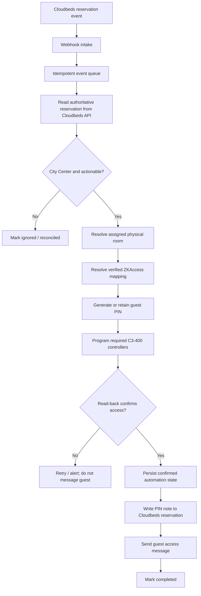
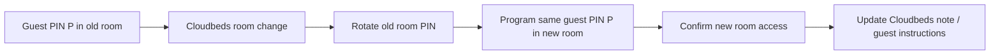

# Cloudbeds → ZKAccess guest PIN automation

Status: **Prepared / not integrated**  
Priority property: **City Center Guest House**  
Cloudbeds Property ID: **7541**  
Timezone: **Europe/Lisbon**

## Goal

When a reservation that requires physical access is created or materially
changed, automatically maintain the correct guest PIN on the ZKTeco access
controllers, record the confirmed PIN on the Cloudbeds reservation, and send
the guest the correct access information.

Cloudbeds is authoritative for reservation state. ZKAccess is authoritative for
whether the physical access programming succeeded.

## Normal flow

## City Center access rule

For Rooms 1–6, the guest receives:

- the room-specific access level;
- Green Kitchen CC Access;
- Green Reception CC Access;
- Street Door CC Access.

The exact controller aliases, door numbers and masks are verified in code/tests.
Network addresses are intentionally not source-controlled; the Windows side
resolves local controller configuration from ZKAccess.

## Events that require reconciliation

The design handles at least:

- reservation created;
- reservation status changed / cancellation;
- reservation dates changed;
- accommodation/room changed;
- accommodation removed from a multi-room reservation;
- reservation deleted.

The webhook is only a trigger. Before a physical write, the worker re-reads the
reservation from Cloudbeds so a stale/retried event cannot override newer state.

## Room change

Rule: **the guest keeps the same PIN**. The old room receives a different PIN so
the previous access ceases to work.

## Cancellation / access revocation

For this project, “revoke access” means replacing the old room PIN with a
different value and confirming the replacement on the controller.

Do not send a guest message saying access was changed until the relevant physical
write has been confirmed.

## Date changes

Date changes must reconcile the current access window/state. If the existing
controller model cannot safely express the required validity without ambiguity,
rotate/reprogram the access rather than assuming the old state is harmless.

## Duplicate and out-of-order events

- Webhook intake is idempotent.
- Repeated delivery of the same event must not create a second PIN/message.
- The authoritative reservation is read after dequeue, not inferred solely from
  the webhook payload.
- A stale event must not revert a newer room, status or date state.

## Cloudbeds reservation note

After the ZKAccess write has been confirmed, add a concise note such as:

`Door PIN: 4826 | Room 2 | Valid: 02/11/2026 14:00 – 04/11/2026 11:00`

The exact text may evolve, but the ordering constraint is persistent:

**physical write confirmed → Cloudbeds note → guest message**

A failed note write must not cause the physical PIN operation to be repeated
blindly. Retry the note/message stage independently from the confirmed controller
state.

## Security boundaries

- Cloudbeds API credentials are private configuration outside the repository and
  outside `public_html`.
- ZKAccess controller network configuration remains on the authorized Windows
  host/ZKAccess database.
- No PIN, API key, password, OTP or guest personal data belongs in repository
  fixtures or logs.
- The public webhook endpoint must remain disabled until private configuration
  is intentionally enabled.
- Webhook receipt alone is never authorization to perform a physical write;
  the reservation is revalidated through Cloudbeds.

## Acceptance checks before production enablement

1. Cloudbeds API/webhook access is active with minimum required scopes.
2. City Center property and room mapping is verified using live API responses.
3. A controlled test creates a PIN and read-back confirms it on the intended
   controllers only.
4. Duplicate webhook delivery produces one effective access change.
5. Cancellation rotates the old room PIN.
6. Room change rotates the old room and reuses the guest PIN in the new room.
7. Multi-room removal affects only the removed accommodation.
8. The Cloudbeds note is written only after successful controller confirmation.
9. The guest message is sent only after the confirmed state is recorded.
10. Failure/retry behavior is tested without duplicate guest messages.
11. Production installed version and the authenticated end-to-end result are
    both confirmed separately.
