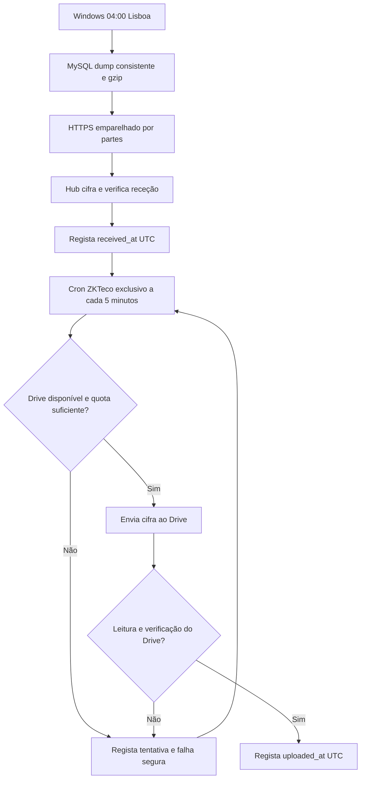

# Backup ZKTeco — fluxo independente do Management Hub

Estado: **implementação preparada; aceitação em produção pendente**. A versão
efetivamente instalada e o agendamento no cPanel devem ser verificados após
o deploy protegido. Não confundir criação de ficheiro, receção no Hub e arquivo
verificado no Drive.

## Objetivo e âmbito

- Base original: `zkeco_db`, MySQL/ZKAccess 5.3 no Windows **AccesControl**.
- O executor Windows mantém o horário diário escolhido pelo Gerente, inicialmente
  **04:00 Europe/Lisbon**. Mantém a regra de um backup por data local e
  `mysqldump --lock-all-tables` para tabelas MyISAM, seguido de gzip.
- O agente emparelhado envia o gzip por HTTPS autenticado, em partes idempotentes,
  para o Hub. Os dados são cifrados no cofre privado, fora do web root.
- Após a receção integral e a verificação de integridade, um **cron exclusivo**
  do cPanel (`cron/zkaccess-backups.php`, cada cinco minutos) envia o ficheiro
  cifrado para `My Drive / Management Hub / ZKTeco Backup`.
- A entrega apenas é considerada concluída depois de voltar a ler o ficheiro do
  Drive e validar tamanho, checksum e decifragem autenticada.
- A retenção do ZKTeco no Drive é de 10 dias, conservando pelo menos duas cópias remotas
  verificadas. Esta redução de 30 para 10 dias é exclusiva dos backups ZKTeco;
  backups gerais do Management Hub e documentos de faturas mantêm as suas políticas.

## Responsabilidades e permissões

- O cron das faturas `cron/invoices.php` não invoca nem bloqueia o envio ZKTeco.
  Os locks MySQL `room_check_invoices` e `room_check_zk_backups` são distintos.
- O worker ZKTeco usa o mesmo lock que a ingestão de partes HTTPS: não lê um
  arquivo que ainda esteja a ser escrito nem executa dois uploads concorrentes.
- O cPanel provisiona a entrada com o WHM já configurado na environment protegida
  do GitHub. `Cron::listcron` verifica antes e depois. Só se adiciona a linha
  exata e exclusiva do ZKTeco; cron desconhecido, alterado ou duplicado bloqueia.
  Nenhum cron existente é apagado ou alterado.
- Apenas quem já tem `zkaccess.configure` pode alterar o horário ou solicitar um
  backup manual; quem tem `zkaccess.view` pode consultar o histórico. O executor
  Windows e os módulos de PIN/Cloudbeds não são alterados.

## Registo e falhas

Os estados ficam no mesmo manifesto cifrado `zkaccess-backups.enc`; nenhum
token, password, PIN, resposta de OAuth ou conteúdo SQL é registado.

- `created_at`: início do envio para o Hub, **não** criação local do dump.
- `received_at`: receção completa após verificação criptográfica (UTC).
- `last_attempt_at`, `upload_attempts`: tentativa de enviar ao Drive, incluindo
  falhas na autenticação OAuth antes do upload (UTC).
- `last_error_code`, `last_error_at`: apenas códigos explícitos permitidos;
  erros inesperados tornam-se `archive_failed`. O backup continua `ready`.
  A última falha fica guardada para diagnóstico, mesmo depois de uma tentativa
  posterior ser bem-sucedida.
- `uploaded_at`: momento em que a leitura de volta do Drive e a verificação
  foram concluídas; estado `uploaded` (UTC).

Para registos anteriores, `verified_at` é a melhor hora conhecida de receção
integral. Não inventar horas de tentativa anteriores à instrumentação.

O cron tenta **uma cópia pronta por passagem**, retoma após falhas do Drive sem
criar novas cópias do mesmo dia, e mantém o identificador remoto atribuído para
evitar duplicações. Erros não alteram o estado das faturas. Espaço/quota do cPanel
insuficiente pode ainda impedir a receção ou o arquivo e exige correção de quota.

## Critérios de aceitação

1. CI obrigatório `validate` e `windows-agent` passam; a reparação
   reversível do clone do cPanel (quando necessária) preserva os ficheiros
   não controlados e permite o deploy da revisão
   integrada confirmado.
2. WHM devolve exatamente uma linha ZKTeco no cron, intervalo cinco minutos,
   sem alterações aos cron de faturas/Cloudbeds/WhatsApp/traduções.
3. Um ciclo privado com backup `ready` regista `last_attempt_at`, confirma
   `uploaded_at` depois de leitura do ficheiro cifrado no Drive e preserva
   `received_at`; uma repetição não faz duplicado.
4. Simular falha de autenticação/quota/rede em testes: estado fica `ready` com
   código seguro, sem expor dados; tentativa seguinte recupera.
5. Confirmar na produção a execução agendada separada e verificar um novo
   backup criado no Windows e arquivado no Drive; apenas o cron instalado não
   constitui prova do ciclo diário completo.
